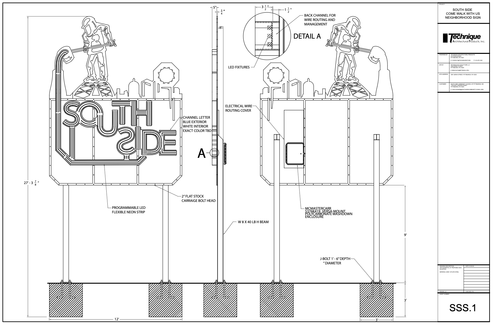
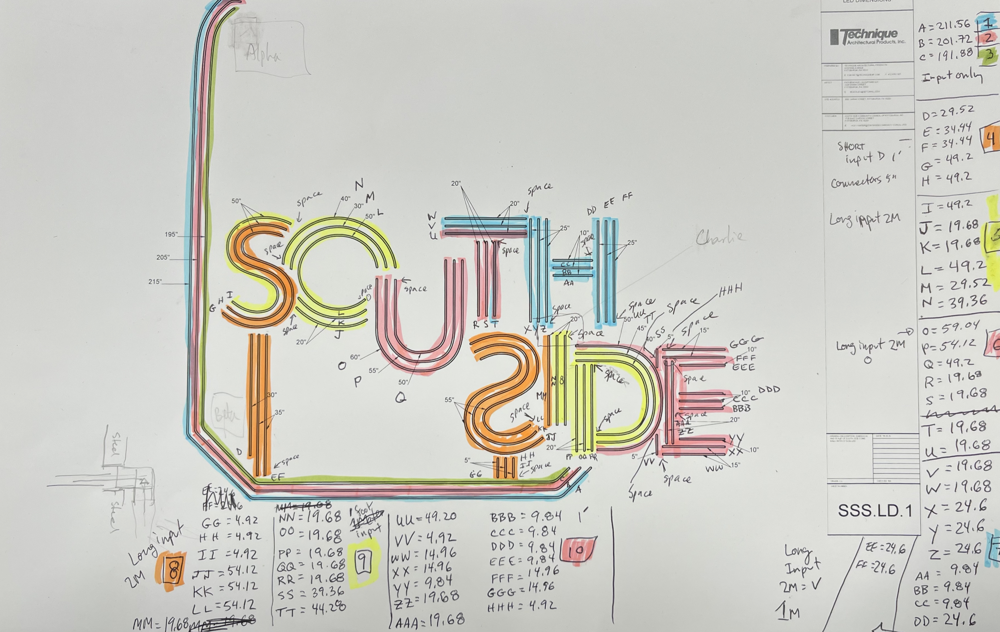
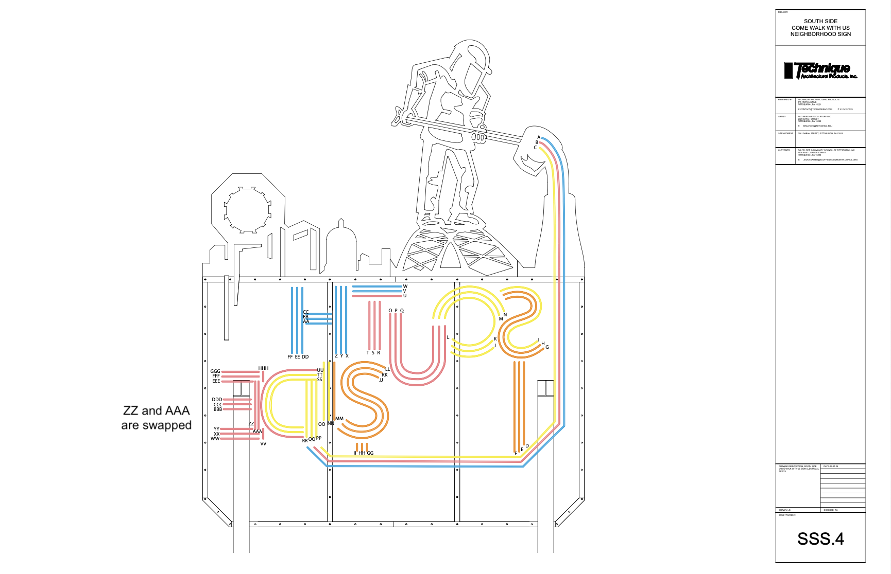
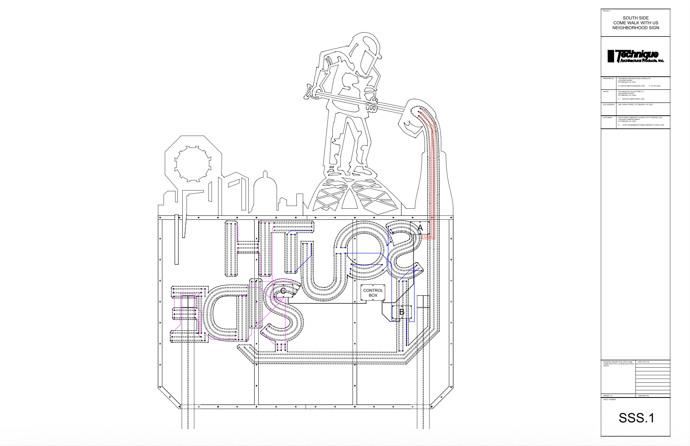
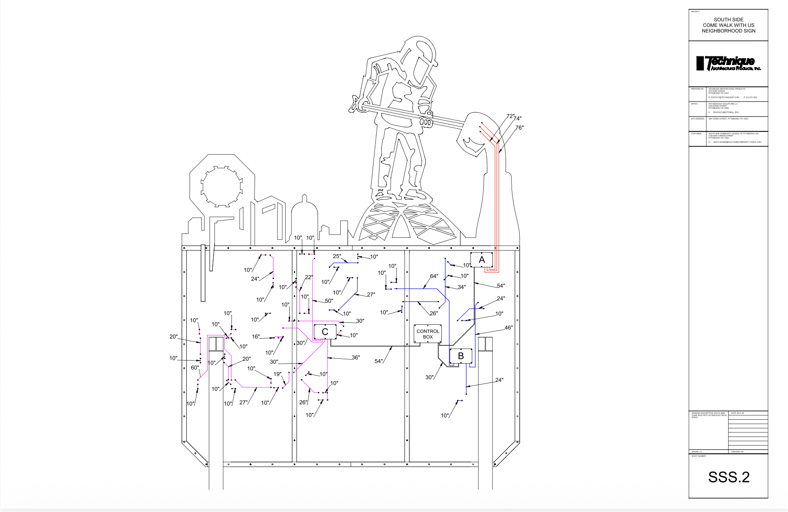
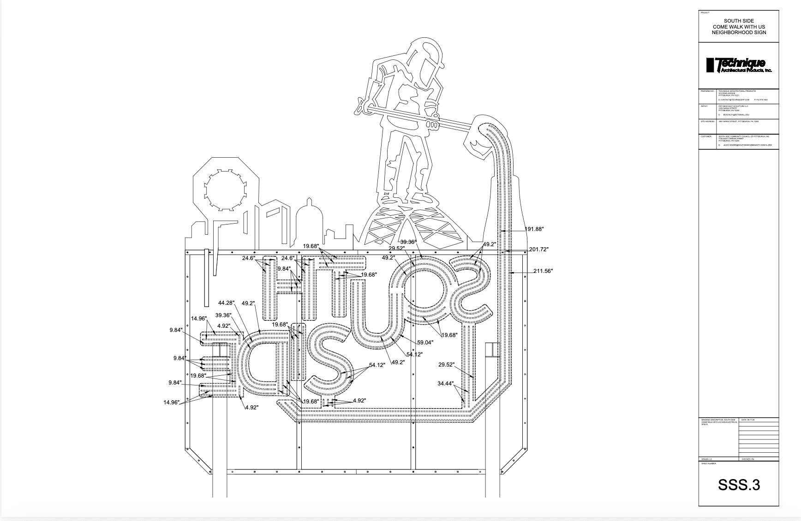

# south-side-pgh-sign

  

  

  

  

  

  

  

---

## [Building](./build.md) the sign

## Sign [Animations](./sequences.md)

---

## Programming the sign

To make new animations for the sign go [here](./programming.md).

  

  

---

## Setting up the [Electronics](./electronics.md)

## Installation
- 3x [Enclosure](https://www.mouser.com/en/ProductDetail/546-1554VB2GY)
- 1x [Enclosure](https://www.mouser.com/en/ProductDetail/Hammond-Manufacturing/1554XA2GY?qs=y6ZabgHbY%252BxxzQxph1WxWg%3D%3D)
- Cable glands, mounting panels, screws, nylon standoffs, lever nuts, pigtails,
  etc.
- [Cat 6](https://www.jefatech.com/products/jefa-tech-shielded-cat6-with-ground-wire)
