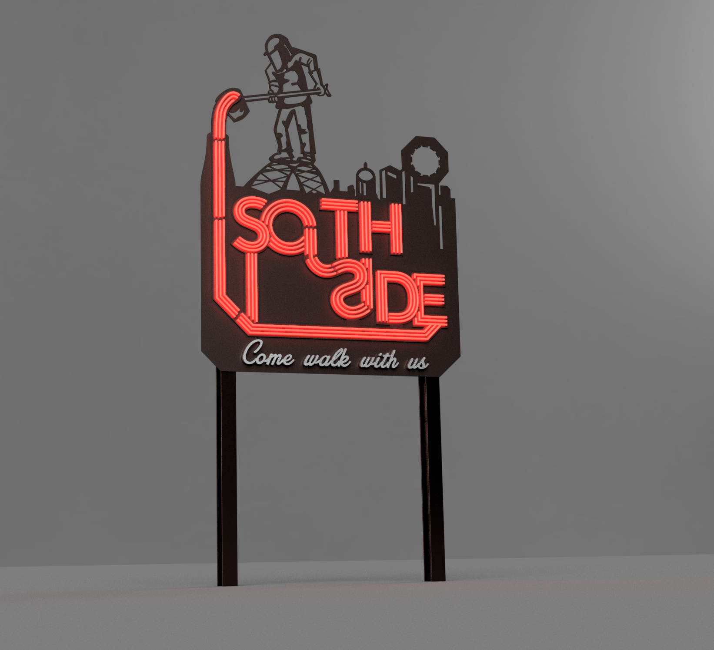
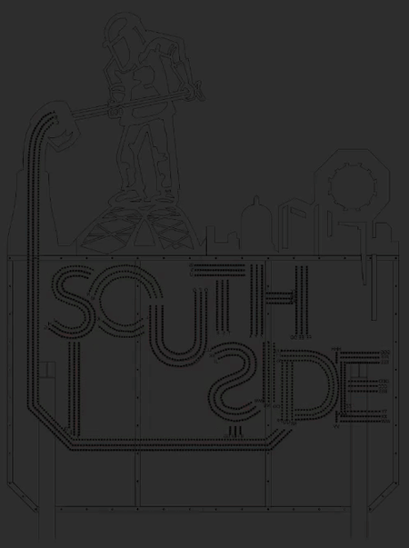
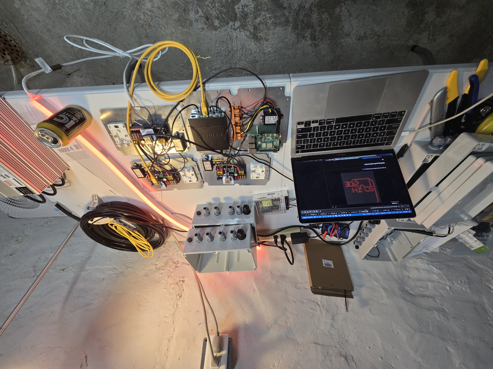

# south-side-pgh-sign

  

---

## [Building](./build.md) the sign

## Sign [Animations](./sequences.md)

---

## [Programming](./programming.md) the sign

  

  

---

## Setting up the [Electronics](./electronics.md)

---

## Acknowledgements

- **Pati Beachley**, Artist: design and project management
- **Ray Appleby**, Technique Architectural Products: fabrication
- **Luke Genter**, Technique Architectural Products: fabrication
- **Mike Clark**, Southside Community Council: site preparation
- **John Wohlbier**, a guy in his south side basement with an iron city: electronics
