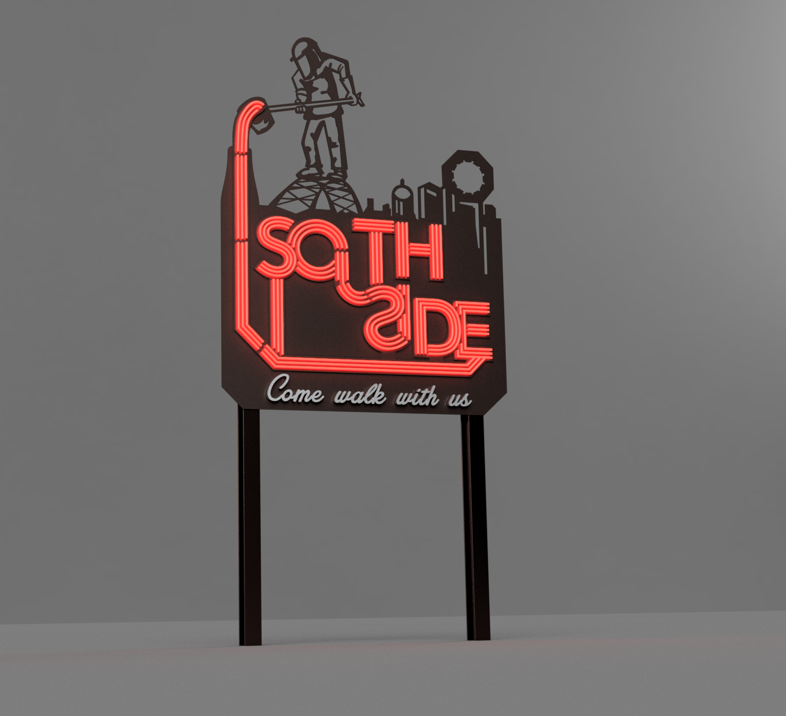
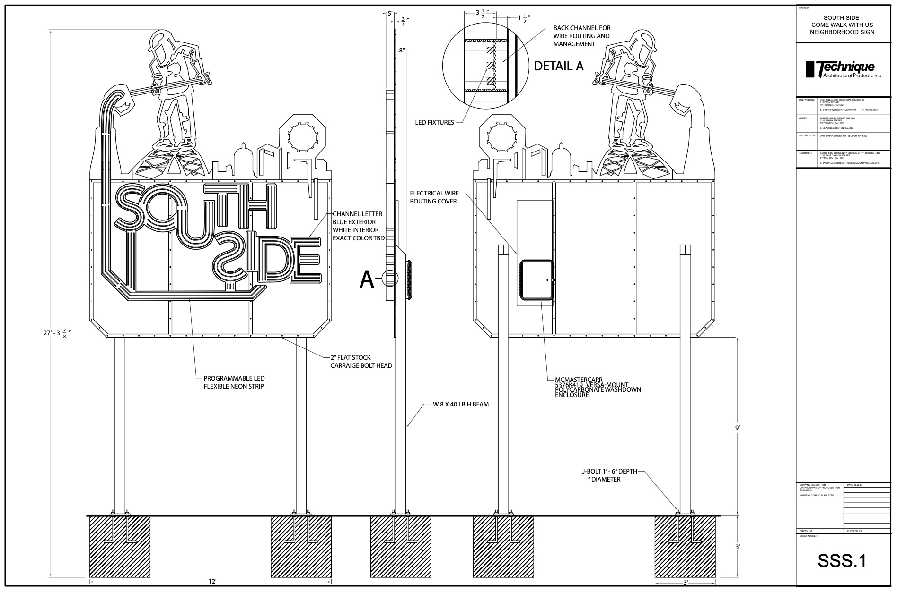
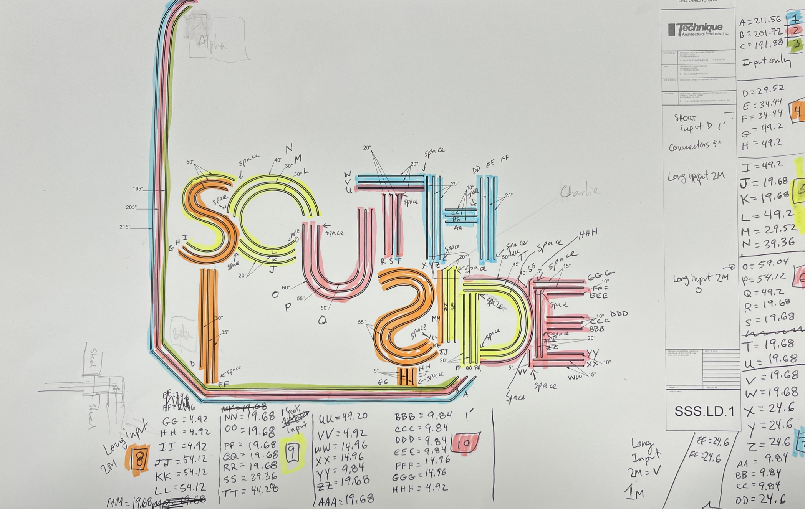
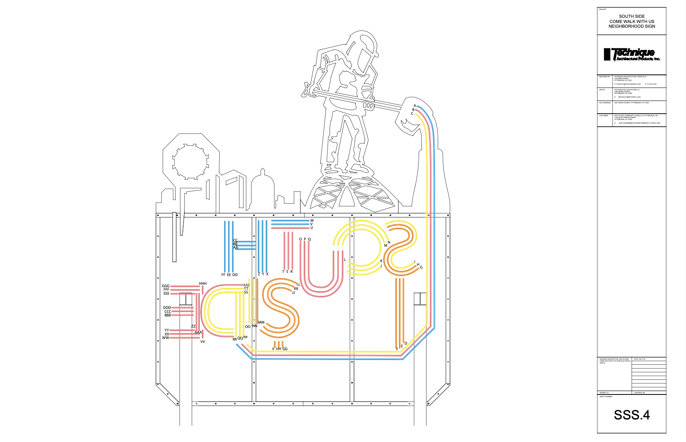
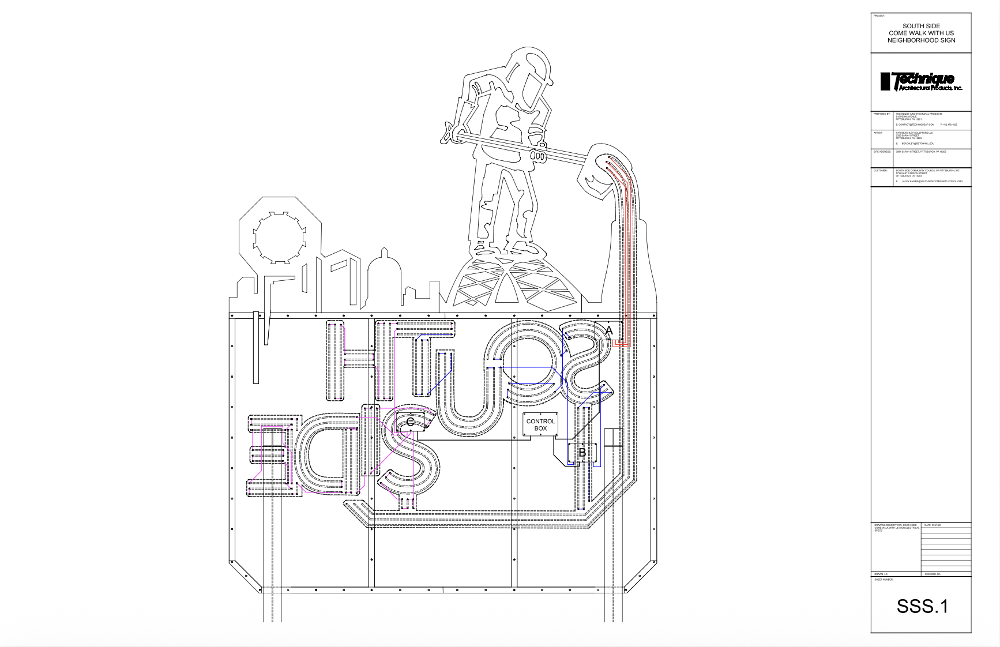
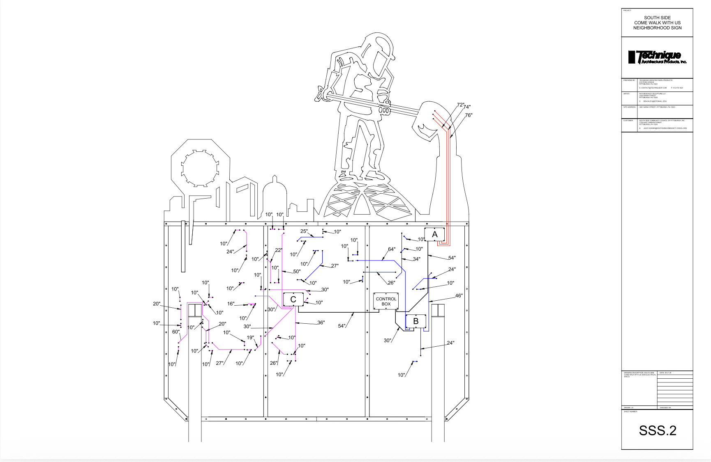
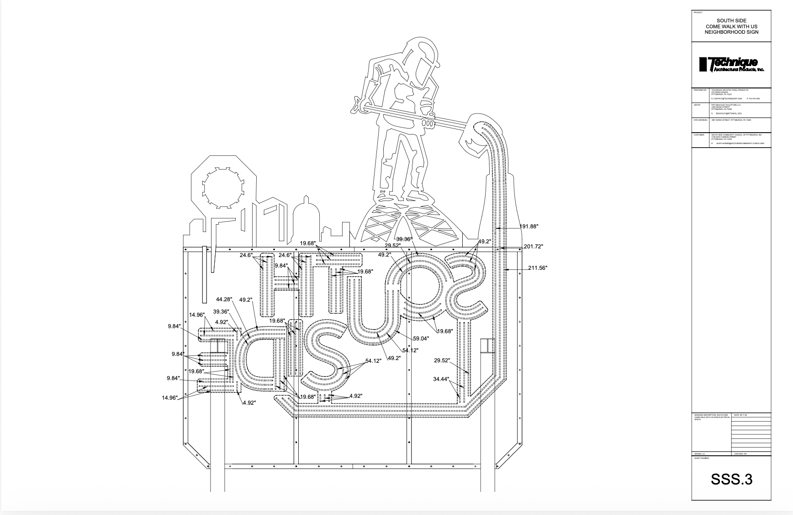
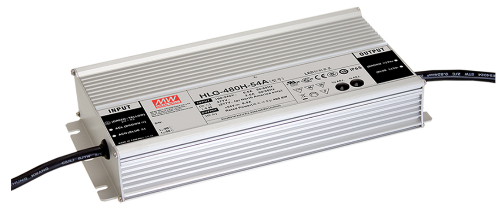

# south-side-pgh-sign

<p align="center">
  
</p>
<p align="center">
  
</p>
<p align="center">
  
</p>
<p align="center">
  
</p>
<p align="center">
  
</p>
<p align="center">
  
</p>
<p align="center">
  
</p>

---

## Programming the sign
To make new animations for the sign go [here](./programming.md).

---
## Setting up the electronics
### Pi
- https://falconchristmas.com/forum/
- Download Pi imager `imager_2.0.10.dmg` install the dmg
- https://www.raspberrypi.com/software/
- Download [FPP-v9.5.3-Pi.img.zip](https://github.com/FalconChristmas/fpp/releases/tag/9.5)
- Run Pi Imager
  - Device: Raspberry Pi 4
  - OS: Use custom, FPP-v9.5.3-Pi.img
  - Storage: Mass Storage Device Media
  - Write

| Device | IP |
| --- | --- |
| Pi (FPP) | 192.168.10.10 |
| Mac (dongle) | 192.168.10.20  (USB 10/100/1000 LAN) |
| Board (WLED) | 192.168.10.50/.51/.52 |

- Connect it to switch
```
# to find it
arp -a
```
- Might have to put mac interface on dhcp. Then navigate to
  http://169.254.140.212/
- "Finish setup", then in FPP status/control network and set static IP to
  192.168.10.10
- Set DNS to 8.8.8.8 and 1.1.1.1, Restart Network
- On mac go back to static IP on ethernet LAN
- From now on use http://fpp.local to access
- For final setup
  - Change SSH/system password
  - Set FPP UI password
  - Set tethering to on and network to phone hotspot SSID
  - Backup configuration into `configs/FPP.json`

---
### [Dig-Quad](https://quinled.info/quinled-dig-quad/)
- Apply [24V fix](https://quinled.info/the-24v-issue-mitigations-fixes/#mitdigquad) if doing final setup
- On initial power-up join WLED-AP wifi, below are some settings
- Upgrade to latest version of WLED through Config, Security and Updates
- Dig-quad IP addresses: 192.168.10.50, 192.168.10.51, 192.168.10.52
- Dig-quad other IP addresses: netmask 255.255.255.0 router 192.168.10.1
- Mac USB interface: 192.168.10.20
- Site for flashing if needed: https://install.wled.me/
- Connect to switch, then can access in browser by IP address

#### [WLED](https://kno.wled.ge/) Notes
- Access via IP, e.g., (http://192.168.10.50)
- LED settings: SK6812/WS2814 RGBW
- One light length: 8
- Color order: RGB
- Data GPIO: 16
- Config -> Sync Interfaces -> E1.31, start universe 1 (11, 21 for B, C),
  bench model RGBW Nodes, and DMX mode Multi RGBW
- For final setup disable WiFi, on all three boards
  - AP Opens: Never
  - Blank the client SSID
  - Set GPIO0 to Pushbutton for emergency physical access restart in
    LED & Hardware
  - Save settings

---
### [xLights](https://xlights.org/)
- Install xLights
- Layout -> Controllers -> Add -> Add E1.31/ArtNET/DDP
  - Name: Dig Quad A/B/C
  - Vendor: WLED
  - Model/Category: QuinLED-Dig-Quad
  - IP Address: 192.168.10.50/.51/.52
  - Protocol: E1.31
  - Active: Active
- Create model(s) (do 10 pixels/node initially to see viz, or Appearance ->
  Pixel Size to 20)
- Layout -> Models -> pick a model -> Controller -> Dig Quad A. Set number of
  nodes to match the number of pixels in the light, and Lights/Node = 1.
  String properties -> String Type: RGBW Nodes, RGB Color Handling:
  R=G=B -> W
- Add models to a metronome sequence
- Apply effects desired until preview looks correct
- Click paint palette - Render All
- While connected to hardware click the light bulb icon to Output to Lights,
  click the loop on the playback, then press play. The LEDs should light
  according to the sequence
- FPP
  - Status/control network and set static IP to 192.168.10.10 (RPi)
  - Set DNS to 8.8.8.8 and 1.1.1.1, Restart Network
  - Use http://fpp.local to access.
  - Input/Output Setup -> Channel Outputs. Outputs Count: 3 (one row per
    board), Set
  - Each row: Active, E1.31 - Unicast, board IP, universe size 512,
    start universe, universe count (pixels / 128, rounded up), Save.
    - Dig Quad A: 192.168.10.50, start universe 1
    - Dig Quad B: 192.168.10.51, start universe 11
    - Dig Quad C: 192.168.10.52, start universe 21
  - Enable Output, Active, Dig Quad A, E1.31 - Unicast, 192.168.10.50,
    universe size 512, start universe 1, Save
  - Status/Control -> Display Testing. Start channel 1, End Channel 32,
    Click Enable Test Mode
  - Go back to xLights
- Tools -> FPP Connect, discovers device. Check upload. Check sequence name.
  Click upload.
- FPP
  - Content setup -> playlists, New Playlist, Add a sequence, add
  your sequence. Set Repeat, play

## Power
- 15W/meter, 5 meter length circuit, 75W/circuit, 75W/24V = 3.125A/circuit
- 4 circuits/driver x 75W = 300W/driver
- 4x 24V/5V buck converters
- 3x [Power supply](https://www.mouser.com/en/ProductDetail/709-HLG-480H-24)
<p align="center">
  
</p>

## Installation
- 3x [Enclosure](https://www.mouser.com/en/ProductDetail/546-1554VB2GY)
- 1x [Enclosure](https://www.mouser.com/en/ProductDetail/Hammond-Manufacturing/1554XA2GY?qs=y6ZabgHbY%252BxxzQxph1WxWg%3D%3D)
- Cable glands, mounting panels, screws, nylon standoffs, lever nuts, pigtails,
  etc.
- [Cat 6](https://www.jefatech.com/products/jefa-tech-shielded-cat6-with-ground-wire)
