# Building the sign

Pictures of building the sign!

---

## Plans
Structural drawing: posts, footings, cabinet and wiring channel

  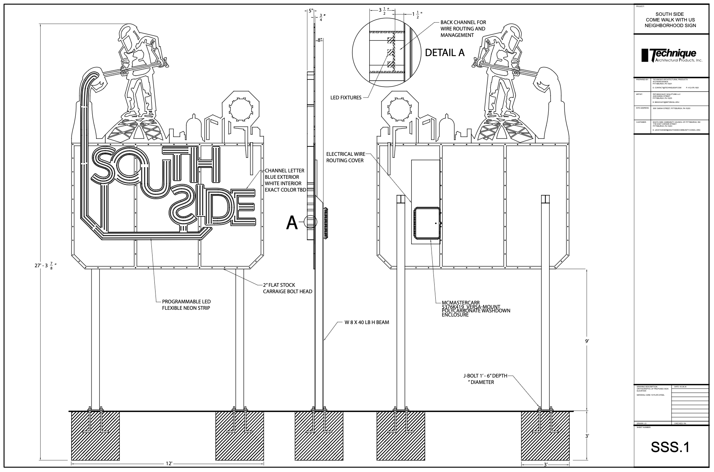

[PDF](./docs/lighting/SouthSideDrawing.pdf)

---

## Fabrication: October 12, 2026

Plate steel on the table, with the frame behind it

  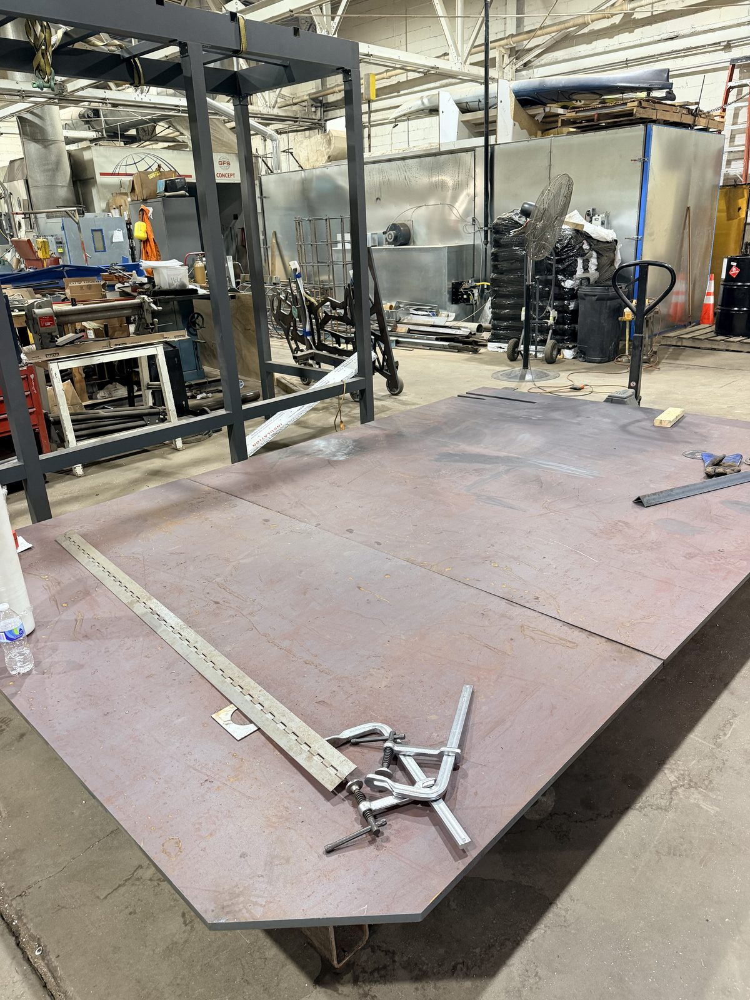

The cut sign panels

  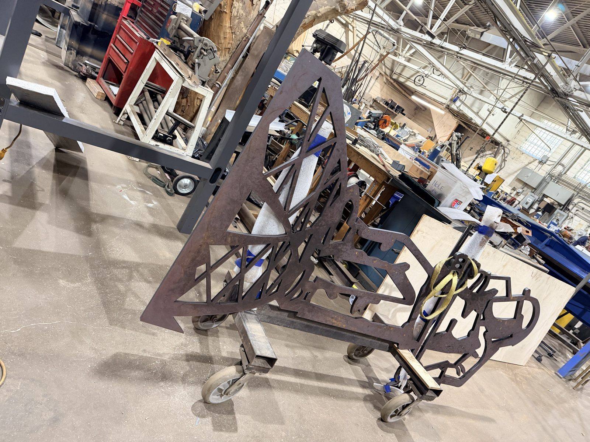

A large cut piece

  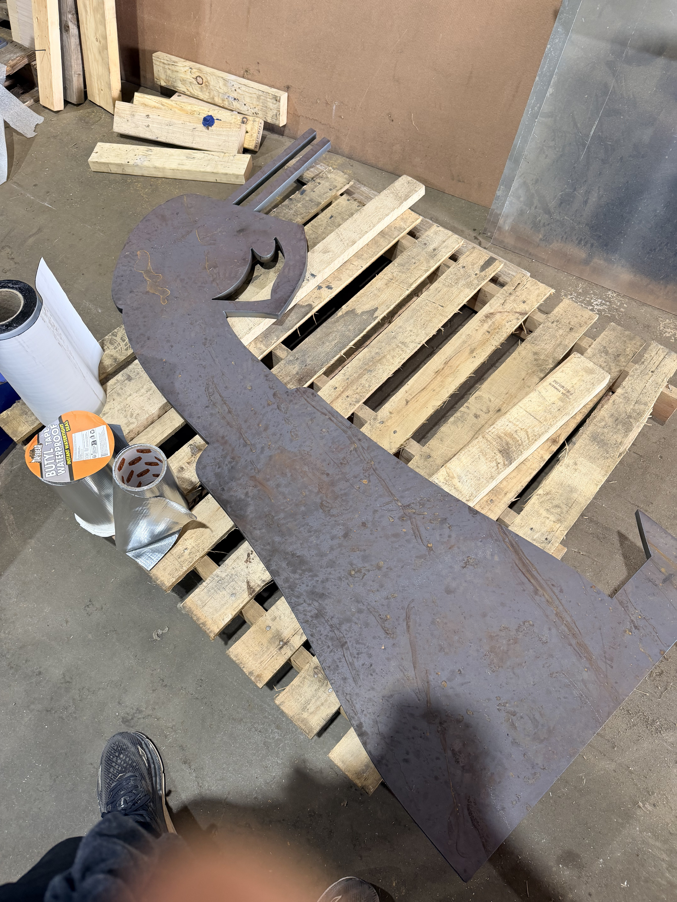

---

## Digging the footings: October 28, 2026

Both holes dug

  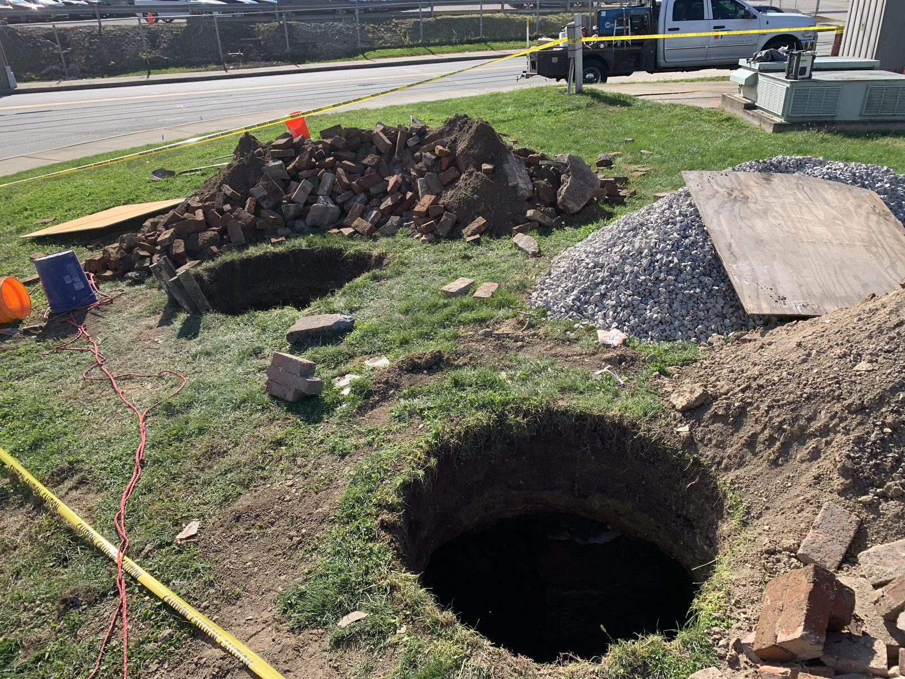

  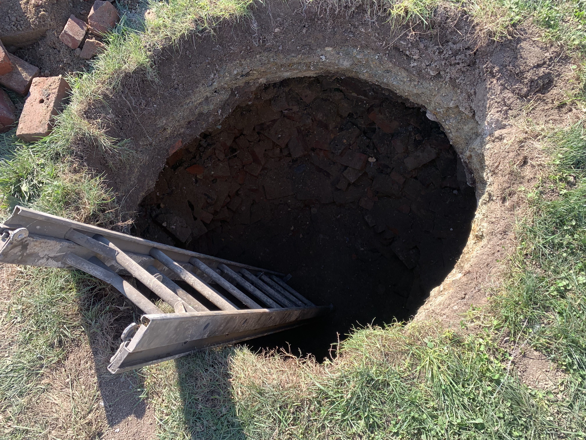

Setting the form tube

  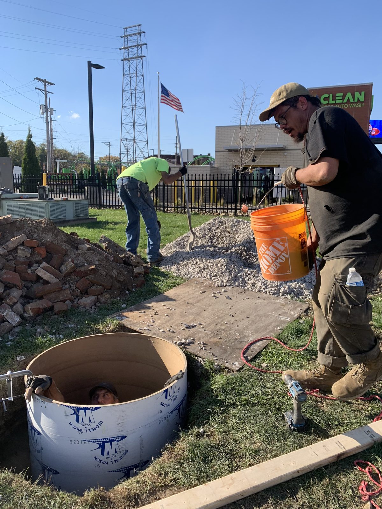

---

## Pouring the footings: October 30, 2026

Form braced and ready

  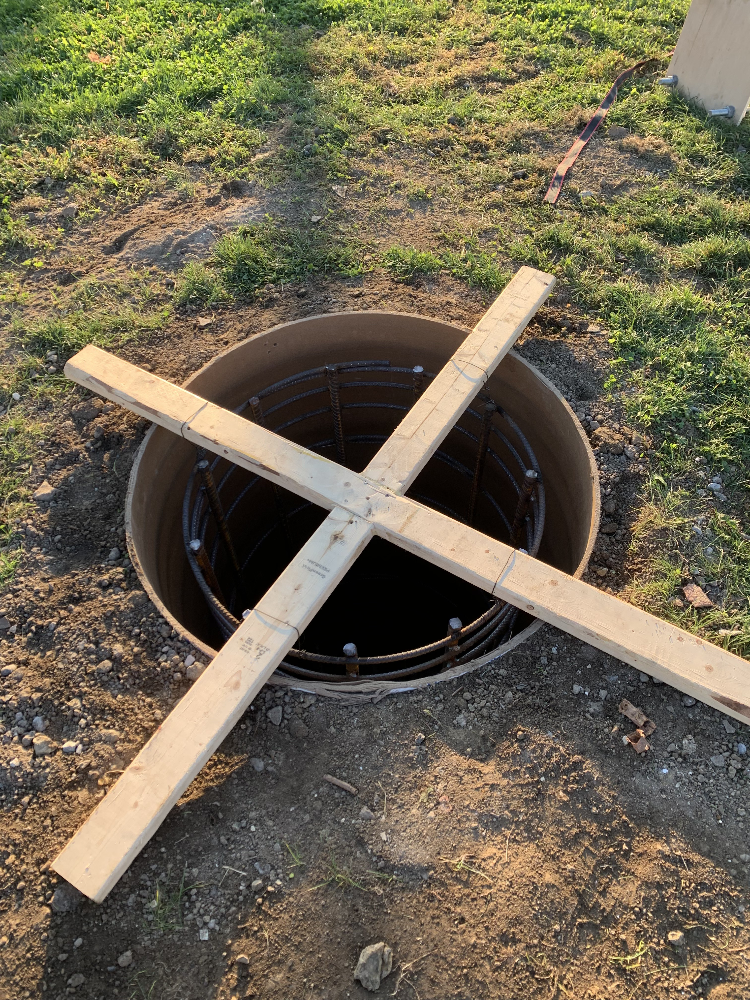

The concrete truck arrives

  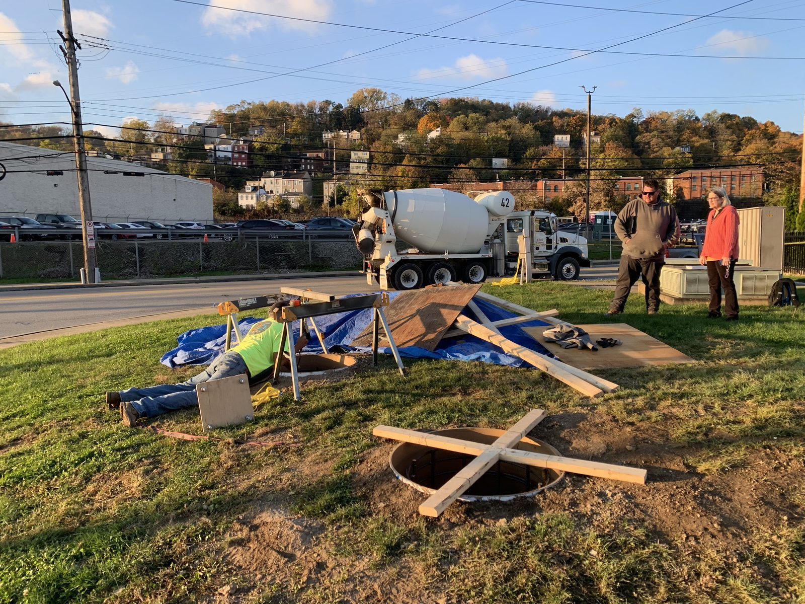

Poured

  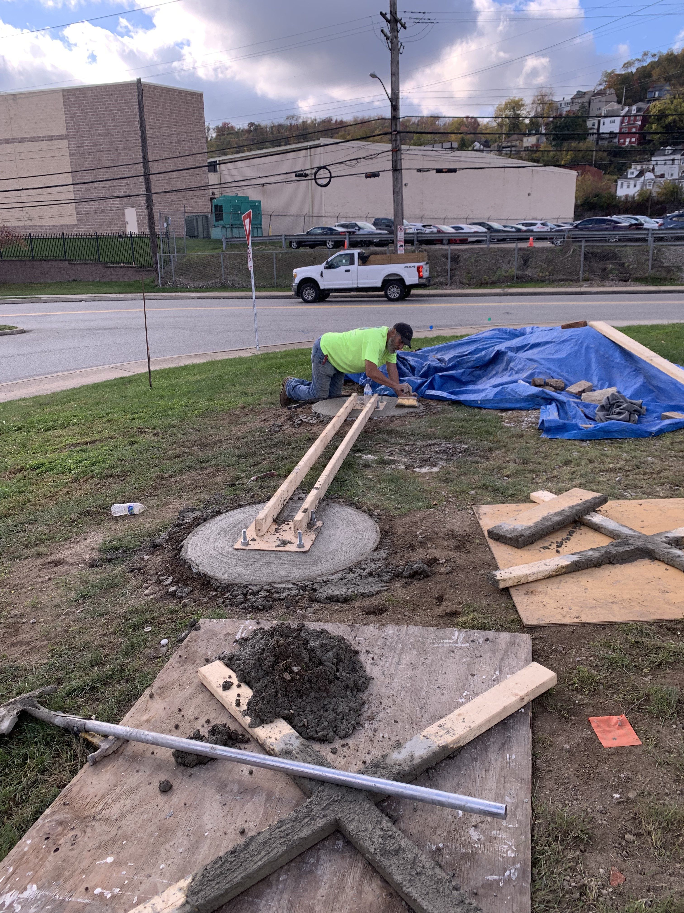

  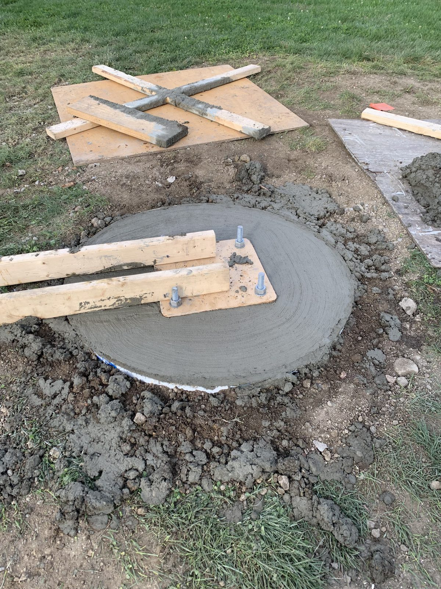

