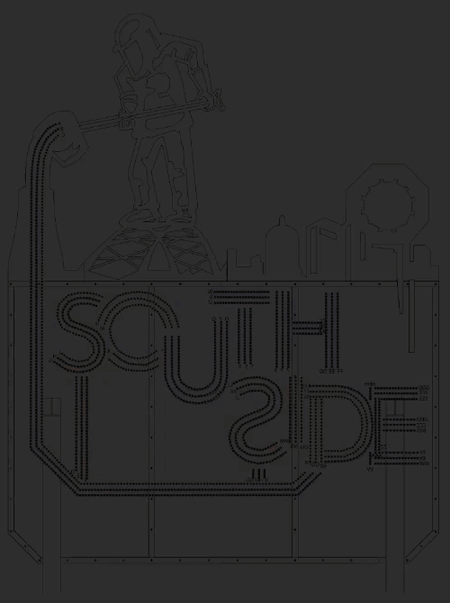
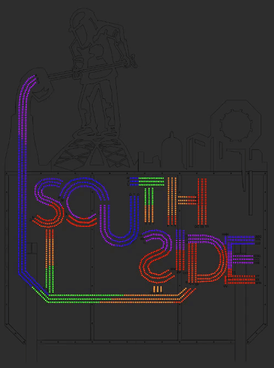

# Sequences
- [Solid](./shows/sign-rev-1/sequences/solid.xsq)
  - Solid steel color

  

- [Molten pour](./shows/sign-rev-1/sequences/Molten%20pour.xsq)
  - Mimics pouring of molten steel in from the top and filling the letters

  

- [Rainbow pour](./shows/sign-rev-1/sequences/Rainbow%20pour.xsq)
  - A rainbow pours in from the top, following the molten pour path, then
    freezes in place once the letters are full

  

- [Rainbow flow](./shows/sign-rev-1/sequences/Rainbow%20flow.xsq)
  - A continuous rainbow flows in from the top of the pour, through the
    letters, and out the top of the H. Loops seamlessly

  

- Put your animation here!
