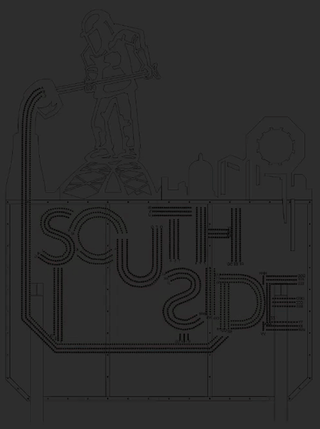
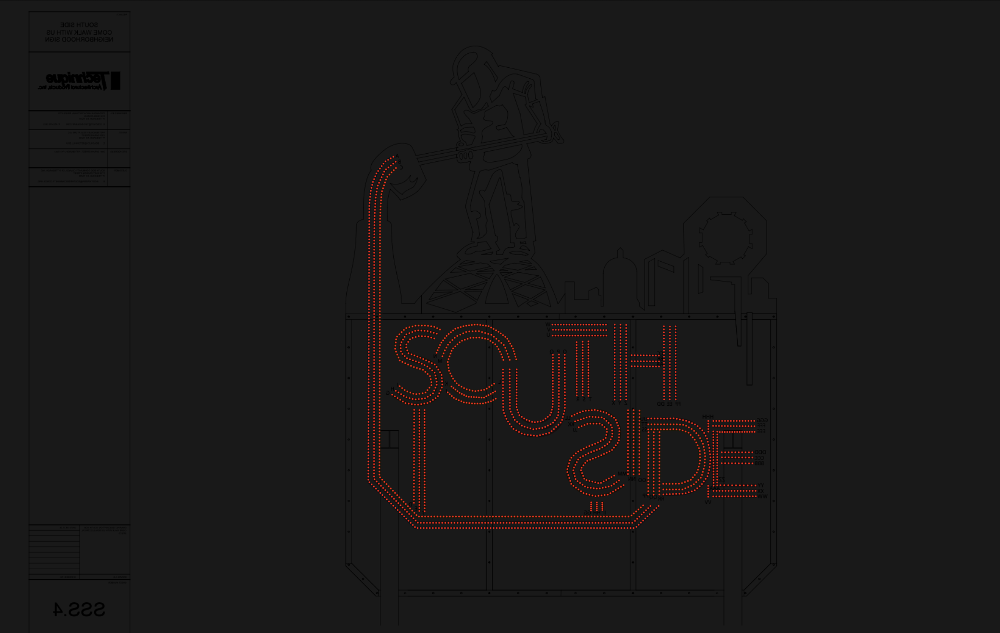

# Sequences
- [Molten fill](./shows/sign-rev-1/sequences/Molten%20fill.xsq)
  - Mimics pouring of molten steel in from the top and filling the letters

  

- [Solid](./shows/sign-rev-1/sequences/solid.xsq)
  - Solid steel color

  

- Put your animation here!
